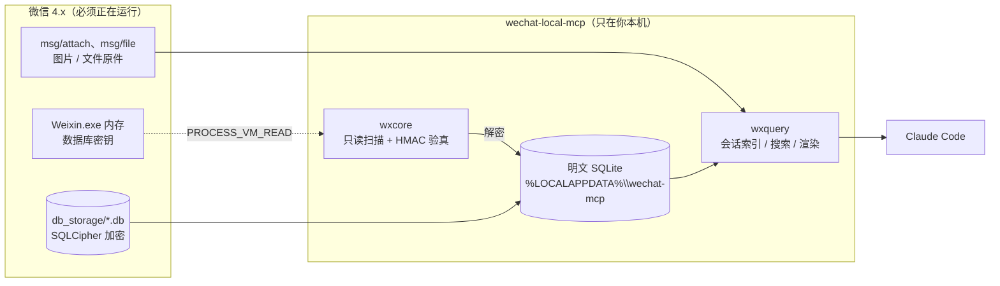

# 微信本地聊天 MCP

> 让 Claude Code 直接读你电脑上**自己的**微信聊天记录。
> 只在本机读写，不联网、不上传、不注入微信进程。


---

## 一图看懂



一句话：**微信把库加密了，密钥只在运行中的微信进程内存里；本工具把密钥读出来、把库解开、再通过 MCP 协议交给 Claude。**

---

## 效果

在 Claude Code 里说「看看我和某某最近聊了什么」，返回长这样：

```text
=== 某某（wxid_xxxxxxxxxxxx，总计 16464 条）最近 12 条 ===
2026-11-10 14:13  我: 我到学校了
2026-11-10 14:13  某某: 好棒
2026-11-10 14:21  某某: （48.7秒）这个方案我看了，前面没问题
2026-11-09 23:52  我: [图片] C:\Users\you\AppData\Local\wechat-mcp\images\a1b2c3d4_9f8e.jpg
2026-11-09 22:40  我: [文件] 需求文档.docx（1.2 MB）
                       本地：D:\xwechat_files\...\msg\file\2026-11\需求文档.docx
2026-11-09 20:00  某某: [集录] 聊天记录，共 12 条
                        甲: 这个先放一放
                        乙: 好
2026-11-09 19:12  我: [引用] 收到
                        原话（某某）：周五之前给我
2026-11-09 09:49  某某: 通话 00:40
2026-11-08 18:30  系统: 你撤回了一条消息
```

---

## 能做什么

| 工具 | 干什么 | 典型用法 |
|---|---|---|
| `list_recent_chats` | 最近有消息的会话，按活跃时间倒序 | 「我最近跟谁聊得多？」 |
| `read_chat` | 看某个人 / 某个群的聊天记录 | 「看看我和导师这周的对话」 |
| `search_chats` | 全库搜关键词（压缩存的消息也会解开再搜） | 「我在哪提过这个项目？」 |
| `refresh_data` | 重新取密钥并解密，看新消息前要刷一次 | 「刷新一下」 |
| `clear_cache` | 删掉本工具生成的明文缓存 | 「把缓存清了」 |

`read_chat` 的 `who` 参数支持**备注名 / 昵称 / 群名 / wxid**，并且支持**片段模糊匹配**；匹配到多个时会列出候选让你选。

---

## 和现成的比，这个有什么用

先说结论：**如果你只是想要一个能用的产品，本项目不是最优选**。GitHub 上已经有做得更全的同类项目。

### 同类项目现状

| 项目 | ★ | 平台 | 路线 | 和本项目的区别 |
|---|---:|---|---|---|
| [stkoecn/im-mcp](https://github.com/stkoecn/im-mcp) | 83 | Windows + macOS | 同样是「读进程内存取密钥 → 解密本地库」，**29 个工具**，有 FTS5 全文索引 | **功能全面得多**，还支持钉钉。想直接用就选它 |
| [bojieli/greenbubbles](https://github.com/bojieli/greenbubbles) | 423 | **仅 macOS** | Rust + Swift，读本地库 | Windows 上用不了 |
| [lich0821/WeChatFerry](https://github.com/lich0821/WeChatFerry) | 6.8k | 仅 Windows | **注入 DLL** 进微信进程，能收发消息 | 是机器人框架，不是历史阅读器；绑定特定微信版本；注入有账号风险 |
| [JettChenT/wechat-mcp](https://github.com/JettChenT/wechat-mcp) | 47 | — | — | 2025-01 之后没再更新，属于微信 3.x 时代 |

### 那为什么还留着这个

**① 它处理语音，别人不处理**

`im-mcp` 的 29 个工具和整篇功能列表里，检索「语音 / voice / 转写 / SILK / audio」**全部 0 命中**。
而语音在微信里占比极高——本项目实测一个账号 **23,718 条语音**。不处理等于整段对话是空的。

本项目从 `packed_info_data` 的 protobuf（字段 5 → 2）里取出**微信自己做的转写**配在消息里，
秒数从 `voicelength` 取。取不到时明确告诉你「没有转写」，而不是丢一个 `[语音]` 就完事。

> 证据等级：检索过对方 README，**也读过对方 `adapters/media.py`、`parser.py`、`tools/key_tool.py` 的源码**。
> 源码里「语音」只作为消息类型标签出现（`34: "语音"`、`17: "实时语音"`），
> 没有 `packed_info_data`、没有转写提取、没有音频解码。这一条是可以核实的。

**② 小到能读完**

7 个文件 **1,739 行** Python，没有框架、没有构建步骤、没有子模块。
想搞明白「微信的库到底是怎么加密的、Claude 是怎么拿到聊天记录的」，从这个仓库读进去比读一个大项目快得多。

**③ 在 4.2.0.9 上跑通过**

实测环境是**微信 4.2.0.9**，密钥掩码沿用 4.1.15.56 那一版，24 个库全部 HMAC 验真通过。

这一条要说清楚，别夸大：读过 `im-mcp` 的 `key_tool.py`，它扫的是
`com.Tencent.WCDB.Config.Cipher` 这个特征串，再拿候选密钥去和库文件的 salt 做 HMAC 比对——
**不是写死内存偏移**，所以版本号差一位大概率不影响，最坏情况是「扫到 0 个密钥」而不是「解出错数据」。
也就是说，`im-mcp` 很可能在 4.2.0.9 上也能用，只是对方没声明测过。

### 它明显不如别人的地方

| 短板 | 说明 |
|---|---|
| **搜索慢** | 没有 FTS5 索引，全库搜索是逐行扫 + 解压，约 **1.3 秒**；`im-mcp` 宣称毫秒级 |
| **工具少** | 5 个 vs 对方 29 个 |
| **不支持 macOS** | 只做了 Windows |
| **不做头像 / 收藏 / 表情包** | 这些 `im-mcp` 都有 |
| **搜索结果没有上下文片段** | 只给命中的那一句，要看前后文得再翻 |
| **不能发消息** | 这是设计选择，不是遗漏——只读才不会动你的微信 |

一句话：**本项目是一个「小而完整、能读懂、把语音也解了」的样本；要功能全，用 im-mcp。**

---

## 消息里那些非文字的东西

| 类型 | 显示成什么 | 靠什么拿到的 |
|---|---|---|
| **语音** | 微信自己的转写文字 + 秒数 | `packed_info_data` 里的 protobuf（字段 5 → 2） |
| **图片** | 解密后的 jpg 路径，可直接看 | `.dat` 三段式解密，见下方 |
| **文件** | 文件名 + 大小 + **本机完整路径** | `msg\file\<年-月>\<原文件名>` |
| **集录**（转发聊天记录） | 标题 + 条数 + 逐条「谁: 内容」 | `<recorditem>` 里的 `<recordinfo>` |
| **引用回复** | 你回的那句 + 「原话（谁）：…」 | `<refermsg>`，套娃引用会往里挖 |
| **通话** | `通话 12:34` | VoIP 气泡里的 `Duration:` |
| **转账 / 系统提示** | 纯文字，不带 XML | `<sysmsg>` 里的 `<content>` |
| 视频 / 表情 | 占位符 | — |

### 语音：只能拿微信转过的

微信 4.x **不在本地保存语音音频**——只在消息里留一条「取货单」：

```xml
<voicemsg voiceformat="4" voicelength="23340" length="41557"
          aeskey="1ac5366da6b055a8657fceaa74eb6e1e" />
```

音频本体按需从腾讯服务器取，播放时在内存里解码、完了就扔（`cache\...\VoiceTemp` 目录是空的）。
所以**对方没触发过转文字的语音，本工具只能告诉你它有多少秒**。

想让它有字，办法只有一个：**在微信里打开「语音自动转文字」**，或在单条语音上长按选「转文字」。
微信转完会把结果写回 `packed_info_data`，本工具下一次就能读到。

> 实测数据：某账号全库 23,718 条语音，微信已转写的只有 442 条（2%）。
> 这个开关不开，绝大部分语音对 Claude 来说是空的。

### 图片：要单独取一次密钥

微信 4.x 的图片存在 `msg\attach\<会话hash>\<年-月>\Img\<md5>.dat`，V2 格式：

```text
[6B 魔数 07 08 56 32 08 07] [4B AES段长] [4B XOR段长] [1B 填充]
[AES-128-ECB 段] [明文段] [XOR 段]
```

- **XOR 键**能从文件自己推（JPEG 以 `FF D9` 结尾），实测固定是 `0xF3`。
- **AES 键没有固定值**，是 16 个 ASCII 字符，**只在微信解码图片那一瞬间进内存**，
  空闲时把整个进程内存扫一遍也扫不到。

所以取密钥要「配合时机」：

```bash
# 1. 在微信里点开两三张图片（看到大图就关掉）
# 2. 立刻运行：
python find_image_key.py

# 抓不到就开监视模式，一边点图一边等它抓：
python find_image_key.py --watch

# 之后验证存下来的密钥还能不能用：
python find_image_key.py --check
```

密钥存在 `%LOCALAPPDATA%\wechat-mcp\imgkey.txt`。**微信重启后可能失效**，失效了重跑一次即可。

**消息和 `.dat` 怎么对上？**
磁盘文件名**不是**消息里的 `md5`（那是另一套，按 md5 一个都找不到）。
真正的对应关系是**明文长度**：

```text
消息 XML 的 length  =  原图解出来多少字节
.dat 的明文长       =  AES段 + 明文段 + XOR段 − PKCS7填充
```

两边一比就配上了。实测一个会话：原图 **23/25** 命中，剩下 2 条用 `cdnthumblength`
对 `_t.dat` 缩略图 **25/25** 命中。

格式推断不用等密钥就能验——造一个假 `.dat` 再解回来逐字节比对：

```bash
python find_image_key.py --selftest
```

### 文件：只给已经下载到本机的

消息里只有文件名和大小；原件在 `msg\file\<年-月>\` 下，按文件名索引，同名多份时用大小和修改时间挑。
没下载到这台电脑的文件，只能告诉你「本地没有」。

---

## 快速开始

### 1. 环境要求

- **Windows 10 / 11**（要读另一个进程的内存，其他系统不支持）
- **微信 4.x 正在运行**（实测 4.2.0.9）
- Python 3.10+

### 2. 装依赖

```bash
pip install -r requirements.txt
```

### 3. 解密一次

```bash
python refresh.py
```

正常会打印：

```text
微信根 : D:\xwechat_files
账号   : D:\xwechat_files\wxid_xxx_7f3a（wxid_xxx）
库目录 : D:\xwechat_files\wxid_xxx_7f3a\db_storage
输出   : C:\Users\you\AppData\Local\wechat-mcp\decrypted

解密 5 个库，用时 20.8s
  [OK] contact\contact.db                 5.12 MB
  [OK] message\message_0.db             103.96 MB
  ...
```

### 4. 注册到 Claude Code

```bash
claude mcp add wechat-local --scope user -- python "<本目录绝对路径>\server.py"
```

重开一个 Claude Code 会话就能用了。

### 5. 自检

```bash
python selftest.py            # 真的连一次服务，把每个工具各调一遍
python selftest.py 某某       # 指定用哪个会话测
```

---

## 配置（都有默认值，一般不用设）

| 环境变量 | 作用 | 默认 |
|---|---|---|
| `WECHAT_FILE_ROOT` | `xwechat_files` 所在目录 | 自动在 `~/Documents`、各盘根目录下找 |
| `WECHAT_ACCOUNT` | 多账号时指定哪个 | 用 `db_storage` 最近改动的那个 |
| `WECHAT_MCP_HOME` | 解密产物 / 图片 / 索引 / 密钥放哪 | `%LOCALAPPDATA%\wechat-mcp` |
| `WECHAT_DEC_DIR` | 单独指定明文库目录 | `%WECHAT_MCP_HOME%\decrypted` |

---

## 工作原理

<details>
<summary><b>① 密钥是怎么从内存里拿到的</b></summary>

微信把 SQLCipher 的密钥放在 `Weixin.exe` 的内存里，外面套了一层固定 32 字节的异或掩码：

1. 在进程内存里搜字符串 `com.Tencent.WCDB.Config.Cipher`
2. 顺着这个 `std::string` 节点的数据指针，找到它的配置对象
3. 配置对象 `+0x88` 处是一个「缓冲区描述符」（指针 + 长度）
4. 把这段字节和固定掩码逐字节异或，还原出 `x'<32字节密钥><16字节盐>'` 字面量

整个过程**只读**（`PROCESS_VM_READ`），不写微信内存、不注入 DLL。
</details>

<details>
<summary><b>② 密钥怎么证明是对的</b></summary>

不靠猜。每把候选密钥都拿去验第 1 页的 HMAC：

```text
mac_key = PBKDF2-HMAC-SHA512(enc_key, salt ^ 0x3A, 迭代 2 次, 32 字节)
HMAC-SHA512(mac_key, 第1页密文 + 页码) == 第1页尾部的 64 字节 ?
```

验不过的一律丢掉。实测某账号 **24/24 个库全部验真**。
</details>

<details>
<summary><b>③ 解密：SQLCipher 4 的页面长什么样</b></summary>

每页 4096 字节，保留区 80 字节：

```text
第 1 页：[16B 盐][4000B 密文][16B IV][48B HMAC][16B 填充]
其余页：[        4000B 密文][16B IV][48B HMAC][16B 填充]
```

逐页 `AES-256-CBC` 解密，第 1 页把前 16 字节换成 `SQLite format 3\0`，
解完再跑一次 `PRAGMA integrity_check`，不通过就报错。
</details>

<details>
<summary><b>④ 为什么消息类型要先 & 0xFFFFFFFF</b></summary>

`local_type` 是个 64 位整数，**高 32 位存来源编号，低 32 位才是消息类型**：

```text
141733920817 & 0xFFFFFFFF = 49   → 卡片消息
```

不掩码的话，卡片、引用、集录全会被认成「未知类型」。
</details>

<details>
<summary><b>⑤ 群消息的发送者怎么认</b></summary>

群消息正文开头是 `wxid_xxx:\n真正内容`，前缀是发送者的 wxid。
但更可靠的是 `real_sender_id → Name2Id.rowid → user_name`，再经 `contact.db` 换成备注名。
`Name2Id` 里有些行的 `user_name` 是空串，这时才退回用正文前缀。
</details>

---

## 隐私与安全

这一节请认真看。

**本工具做了什么**

- ✅ 只读打开微信进程内存，不写、不注入、不改微信的任何状态
- ✅ 所有数据**只在本机**，不联网、不上传、不写日志到外部
- ✅ 解密产物的唯一判据是 HMAC 验真，不会把错钥匙解出来的垃圾当数据

**你需要知道的**

- ⚠️ **解密产物是明文**，默认在 `%LOCALAPPDATA%\wechat-mcp\decrypted\`（约 200 MB）。
  任何能读你用户目录的程序都能读到它。用完可以 `python refresh.py --purge` 清掉，
  或让 Claude 调用 `clear_cache`。
- ⚠️ **内容进了对话就等于出去了。** 本工具本身不联网，但 Claude 读到的聊天内容会随对话
  发给模型服务端。删掉本地缓存**不等于**内容没离开过这台电脑。
- ⚠️ 别把这个仓库连同 `%LOCALAPPDATA%\wechat-mcp\` 一起同步到网盘或公共机器。

---

## 已知限制

| 限制 | 说明 |
|---|---|
| 只支持 Windows | 要读另一个进程的内存，用 Win32 API |
| 只支持微信 4.x | 3.x 的库结构和路径都不一样，没做适配 |
| 语音只给转写文字 | 音频不在本地，见上文 |
| 图片要先取密钥 | 微信重启后可能要重取 |
| `wxgf` 长截图解不出画面 | 微信自有的长图格式，不是 JPEG/PNG/WebP/H.264；会自动退回同一条消息的缩略图（缩略图一定是 JPEG） |
| 文件只给已下载的 | 没下载的只有文件名和大小 |
| 视频、表情只有占位 | — |
| 公众号推送不在范围 | `biz_message_*.db` 不解 |
| 没加好友的人显示 wxid | 依赖 `contact.db` 的备注/昵称 |
| 大版本升级后可能失效 | 内存掩码可能变，届时 `refresh.py` 会明确报「一个密钥都没验过」 |

---

## 排错

<details>
<summary><b>报「打不开微信进程」</b></summary>

- 微信没开，或者开了但立刻退出了
- 微信以**管理员身份**运行，而本工具不是 → 两边权限要一致（都用普通权限，或都用管理员）
</details>

<details>
<summary><b>报「一个密钥都没验过」</b></summary>

微信升级后内存掩码变了。`wxcore.py` 里的 `MASK` 需要重新找。
</details>

<details>
<summary><b>看不到刚聊的消息</b></summary>

让它调用 `refresh_data`，或自己跑一次 `python refresh.py`（约 10 秒）。
微信必须正在运行——密钥只在内存里。
</details>

<details>
<summary><b>图片显示「还没取图片密钥」</b></summary>

先 `python find_image_key.py --check` 验证存的密钥，
不通就 `python find_image_key.py --watch`，然后去微信里点几张图。
</details>

<details>
<summary><b>语音显示「没有转写」</b></summary>

微信自己没转过这条。去微信设置里打开「语音自动转文字」。
</details>

---

## 目录结构

```text
wechat-local-mcp/
├── server.py           MCP 服务入口（Claude Code 启动时自动拉起）
├── wxcore.py           找目录 / 内存取密钥 / 逐页解密
├── wxquery.py          通讯录映射 / 会话索引 / 搜索 / 富媒体渲染
├── wxmedia.py          语音转写 / 文件索引 / 集录解析 / .dat 解密
├── find_image_key.py   从微信内存取图片 AES 密钥
├── refresh.py          命令行手动刷新（--purge 清缓存）
├── selftest.py         自检：真连一次 MCP 服务
├── requirements.txt
└── LICENSE
```

运行期产物（**不在仓库里**，默认在 `%LOCALAPPDATA%\wechat-mcp`）：

```text
decrypted/    解密后的明文 SQLite（约 200 MB）
images/       解出来的图片
index.json    会话索引缓存
imgkey.txt    图片密钥
```

---

## 免责声明

本项目仅供**读取自己账号在本机的聊天记录**，用于个人数据整理与自动化和学习研究。

- 请勿用于读取他人设备、绕过他人授权或任何未经同意的场景。
- 微信的用户协议可能不鼓励此类本地数据访问，使用前请自行了解并承担相应风险。
- 作者不对因使用本工具造成的任何数据丢失、账号异常或法律后果负责。

---

MIT License © 2026 Lyric679
